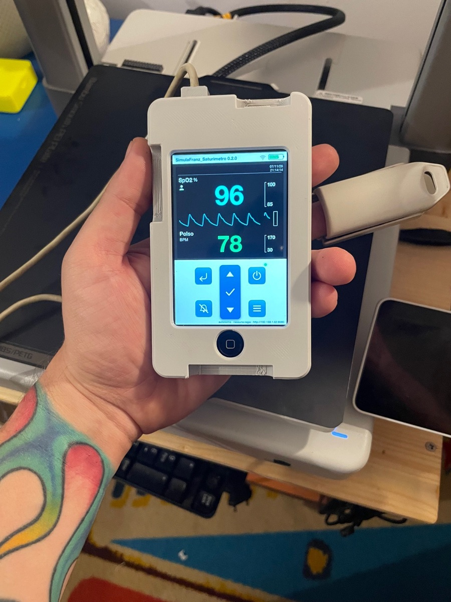
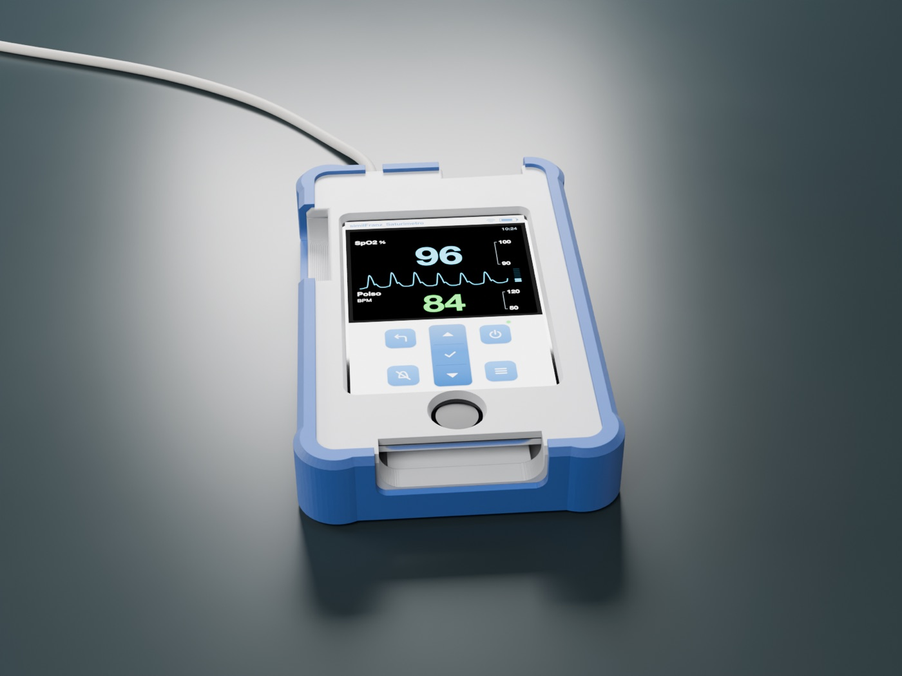
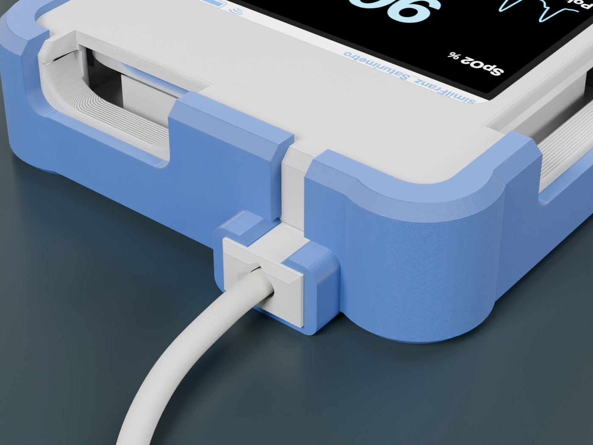
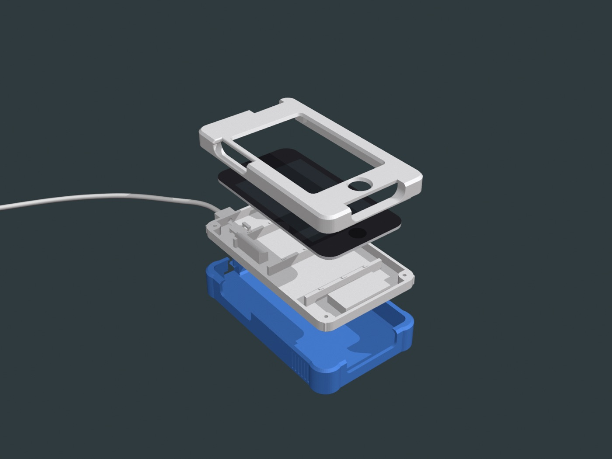
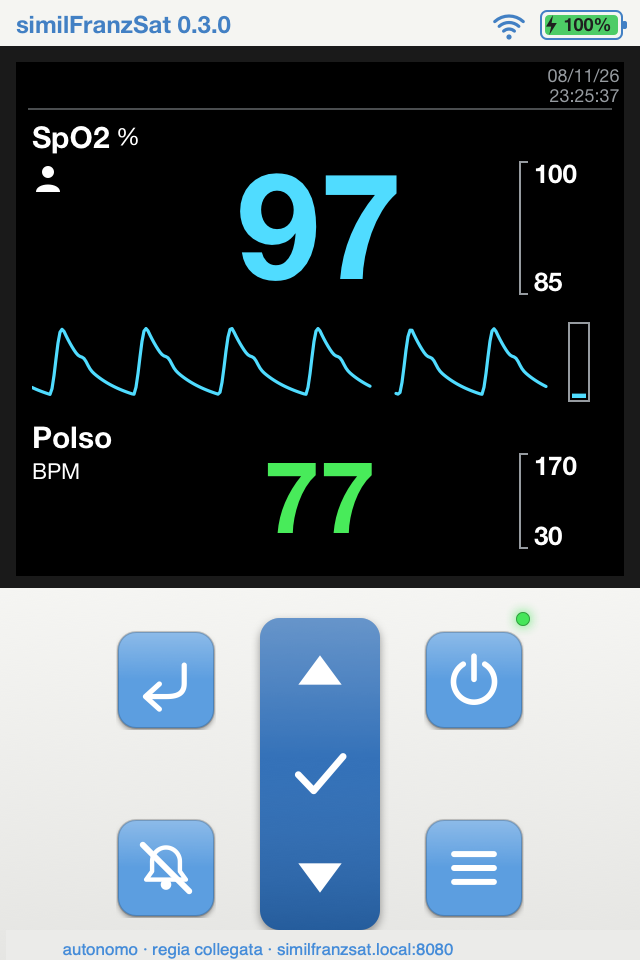
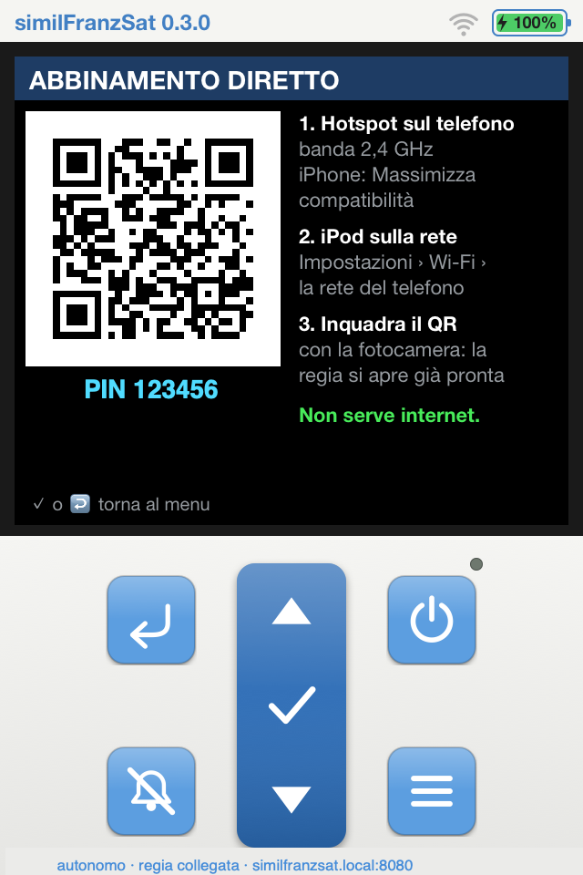
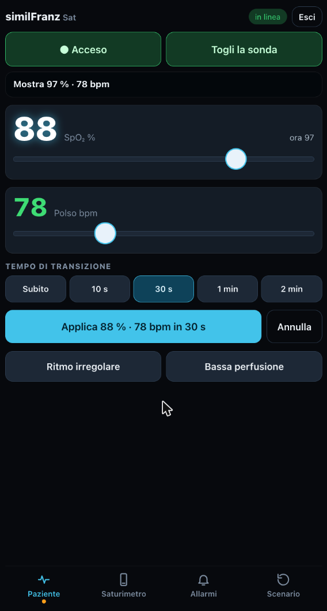
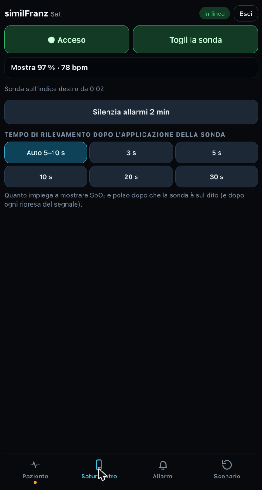

# similFranz Saturimetro

🇮🇹 [Leggi in italiano](README.md)

**That old iPod touch 4 in the drawer still has one more shift to work.**

With a 3D printer and an afternoon of tinkering it becomes a simulation pulse oximeter:
SpO₂, pulse rate, plethysmography and alarms, all driven from your phone. Put it in your pocket
and take it wherever you need it: the sim lab, the ward, your next course.

  

  
  
  

> **For simulation and education only.** It is not a medical device and measures nothing:
> use it exclusively in training scenarios, never on patients.

The app and the guides are in Italian; this page is a summary for international readers.

## What you get

- **A device that behaves like the real one.** Values appear after a few seconds of pulse search,
  the pulse tone drops with saturation, alarms flash and sound according to their priority.
- **A real finger sensor.** The case has an inlet for the cable of a probe salvaged from a
  retired oximeter: participants apply it exactly as they will on the ward.
- **The control room in the palm of your hand.** Scan the QR code on the iPod screen and your phone's
  browser becomes the instructor console: power and probe always under your thumb, SpO₂ and pulse
  changed instantly or with a gradual transition up to 2 minutes, irregular rhythm, low perfusion,
  and how long the device takes to find the pulse once the probe is on the finger.
- **Total freedom.** No router, no internet, no subscriptions: your phone is the hotspot,
  the iPod does everything else.
- **Ready for everyone's hands.** A TPU bumper, soft on the corners and just stiff enough, protects it
  from drops and makes it comfortable to hold.

## What it costs

A commercial app-driven simulation oximeter costs around €1,300.
This one costs the iPod you already own, about sixty grams of PLA, four threaded inserts and four screws.
Software and 3D models are free and open source.

## There is one in every drawer. Literally.

Between 2010 and 2013 Apple sold more than 50 million iPod touch units, and for most of that time the
model on sale was the 4th generation. Many of them now sit switched off in a drawer, waiting for a
reason to come back on. If yours is missing, second-hand ones go for a few tens of euros.

**What about the battery?** After so many years it is not what it used to be. But a simulation scenario
does not last a whole day: even one hour of battery life is plenty.

Every iPod back in the sim lab is one device fewer in the e-waste stream: in 2022 the world produced
62 million tonnes of it, and only 22.3% was documented as collected and recycled.

Sources: see the [Italian README](README.md#ce-nè-uno-in-ogni-cassetto-letteralmente).

## What you need

- **iPod touch 4th generation** (model A1367) on iOS 6.1.x
- **A Mac** (or a Linux PC), only for the first install
- **A 3D printer** for the case, 4 × M2 threaded inserts and 4 × M2×12 screws
- **Your phone**, iPhone or Android, to run the scenario
- optional: **the finger sensor** of an old oximeter
- optional: **about 30 g of TPU** for the bumper

## The device and the console

  
  
  
  

No app to install on the phone and no internet: the iPod is the server, the phone is the remote.

On the iPod itself the keys work like on a real handheld oximeter. When the probe goes on the simulated patient
you choose who tells the device: the instructor, from the console (or with a tap on the screen), or the participant
on their own, with a tap. Tapping the SpO₂ or pulse value opens its alarm limits.

## Four steps, one afternoon

1. [Jailbreak the iPod](docs/01-jailbreak.md): a free tool, once.
2. [Install the app](docs/02-installazione.md): one command from the Mac.
3. [Print and assemble the case](docs/03-stampa-montaggio.md): two parts, one print plate. Plus the TPU bumper if you like.
4. [Take the scenario to the room](docs/04-uso-col-telefono.md): phone hotspot at 2.4 GHz (on iPhone: *Maximize Compatibility*), scan the QR code, go.

Want to dig deeper? Everything is in [For developers](docs/sviluppo.md) (Italian).

**Using Claude Code?** Open this folder and ask it to *"install the oximeter on my iPod"*:
its instructions are already in [`CLAUDE.md`](CLAUDE.md).

## Work in progress

The oximeter is the first piece of something bigger, made of other old Apple devices
that become useful again for simulation. Star the project to be among the first to see it.

## Make it yours

It is made for **simulation educators, instructors and facilitators**, and for anyone with a device
to rescue from the drawer. Build it, adapt it to your scenarios and tell us what you improved: open an
*issue* or propose a change. Every idea makes the tool better for the whole simulation community.

## Good to know

- **It is a training simulator**: not a medical device, and it does not replace any clinical instrument.
- **The jailbreak** is done on your own device, at your own risk. The project points to the official
  public tools and does not distribute any Apple files.
- Software and models are provided **"as is"**, without warranty (see licenses).
- "iPod" and "iPod touch" are trademarks of Apple Inc., mentioned only to identify the compatible device.
  The project is independent of Apple and of any medical or simulation device manufacturer.

## Licenses

- Code (`app/`): [GNU GPL v3](LICENSE). You may use, modify, share and even sell it, but anyone who distributes
  the project or a modified version must make the source available under the same license:
  every improvement goes back to the community. Copyright (C) 2026 ilFranz.
- 3D models (`stampa3d/`): [CC BY-NC 4.0](stampa3d/LICENSE): print, modify and share them with attribution, not for sale.

An open source project by **ilFranz**, simulation educator with a screwdriver always within reach.
