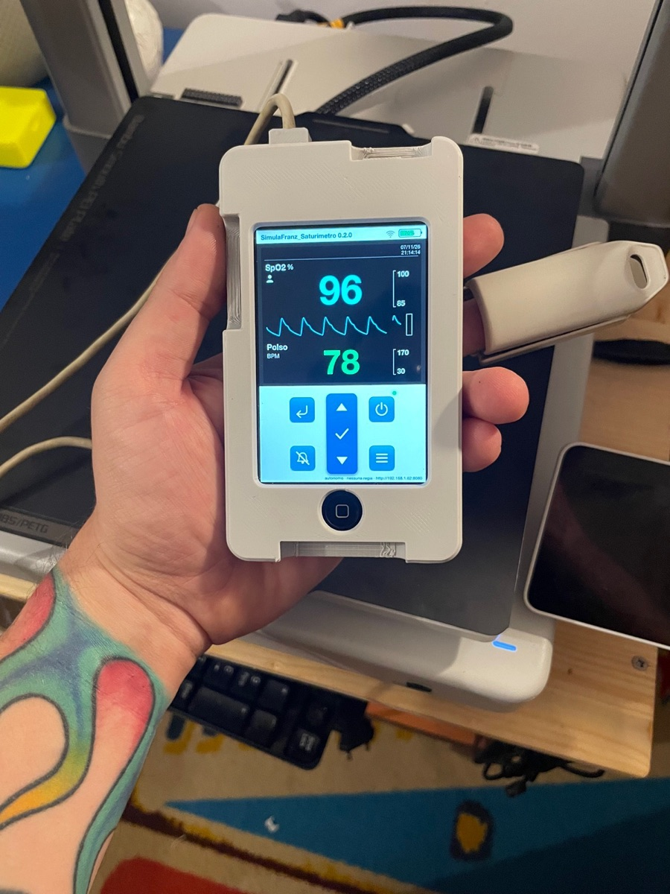
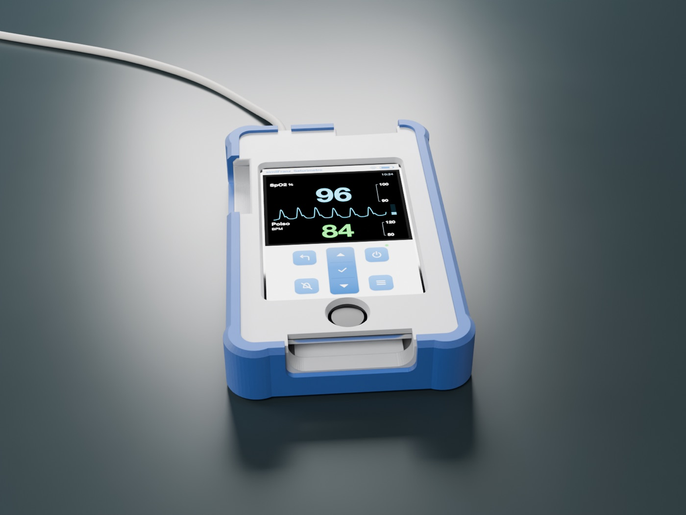
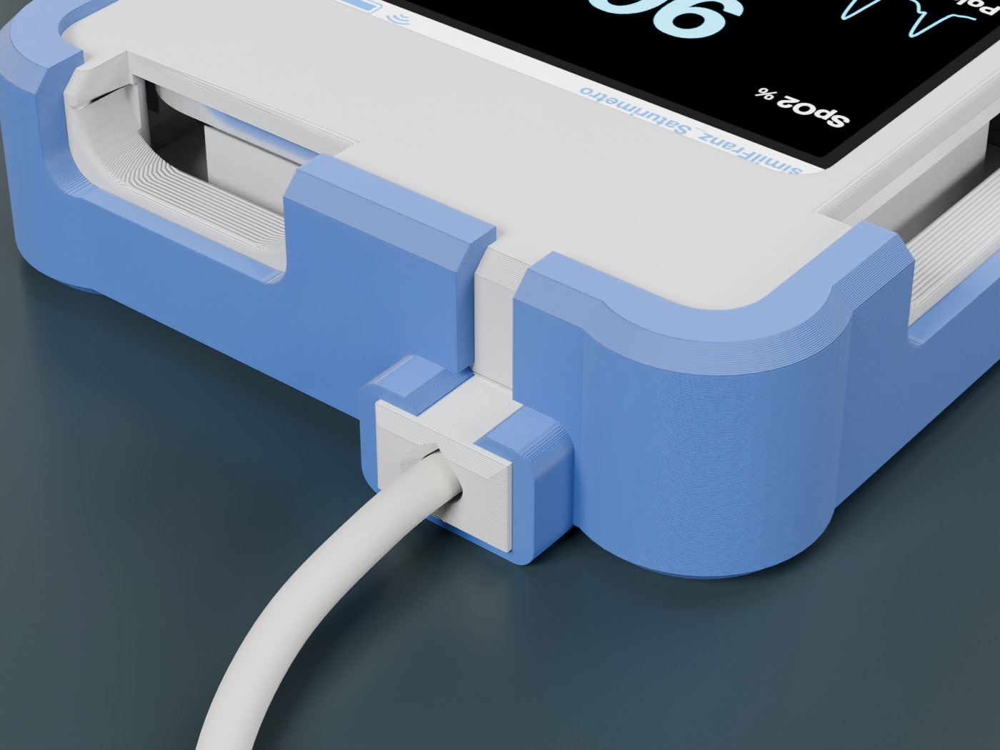
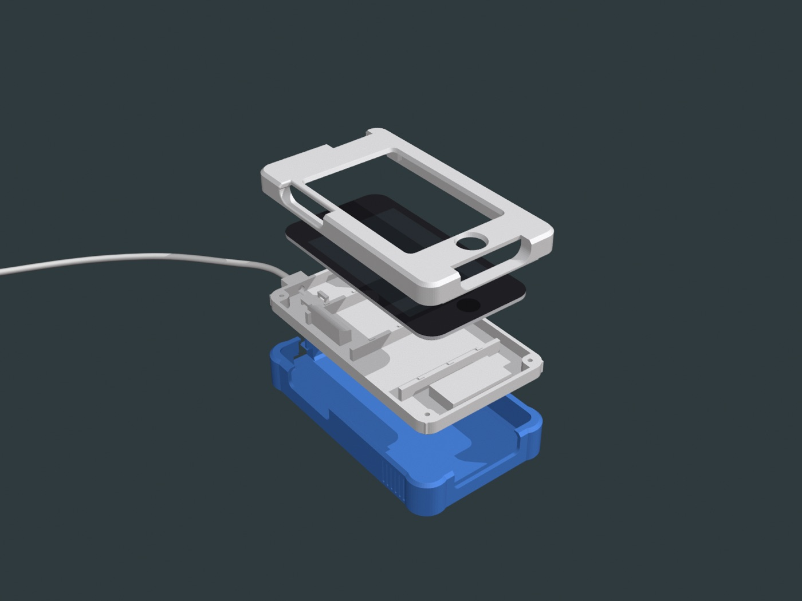
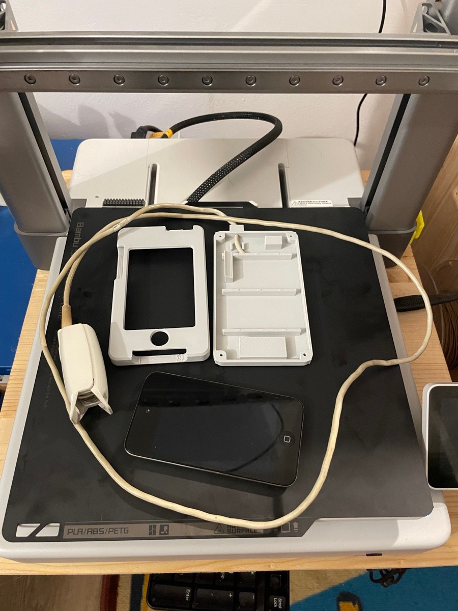
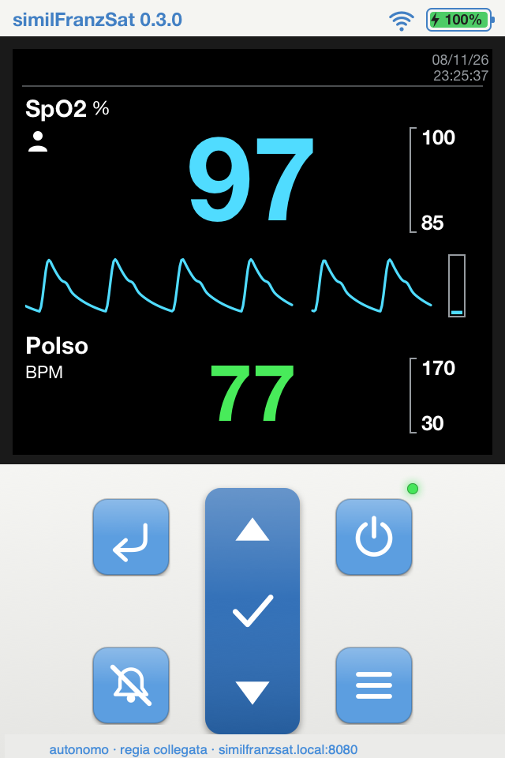
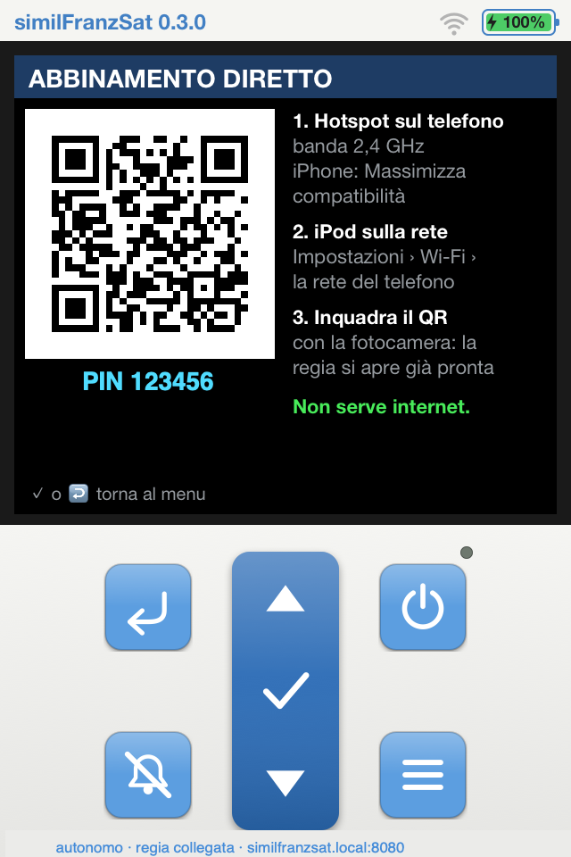
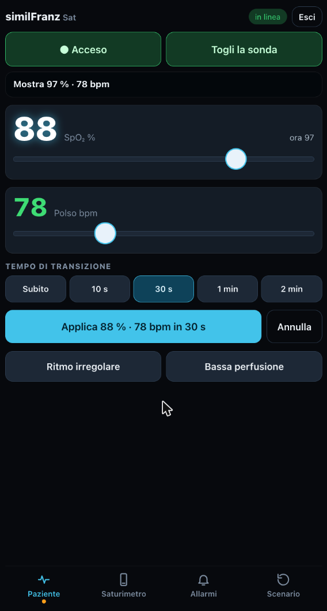
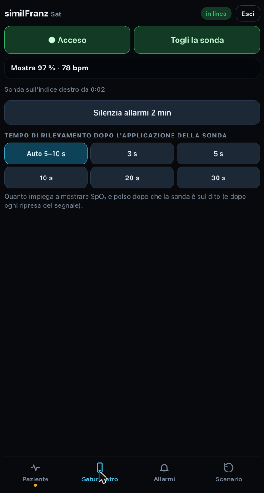

# similFranz Saturimetro

🇬🇧 [Read in English](README.en.md)

**Quel vecchio iPod touch 4 nel cassetto ha ancora un turno da fare.**

Con una stampante 3D e un pomeriggio di smanettamento diventa un saturimetro da simulazione:
SpO₂, polso, pletismografia e allarmi, che comandi dal tuo telefono. Lo metti in tasca
e lo porti dove serve: in sala, in reparto, al prossimo corso.

  

  
  
  

> **Solo per simulazione e formazione.** Non è un dispositivo medico, non misura nulla:
> usalo esclusivamente in scenari didattici, mai su pazienti.

## Cosa ti porti a casa

- **Uno strumento che si comporta come quello vero.** Il valore compare dopo qualche secondo di ricerca,
  il tono del polso scende con la saturazione, gli allarmi lampeggiano e suonano con la loro priorità.
- **Un vero sensore da dito.** Il guscio ha l'ingresso per il cavo di una sonda recuperata da un
  saturimetro dismesso: il partecipante la applica come farà in reparto.
- **La regia nel palmo della mano.** Inquadri il QR sullo schermo dell'iPod e il browser del telefono
  diventa la console: accensione e sonda sempre a portata di pollice, SpO₂ e polso subito o con una
  transizione graduale fino a 2 minuti, ritmo irregolare, bassa perfusione e il tempo che lo strumento
  impiega a trovare il polso dopo che la sonda è sul dito.
- **Libertà totale.** Niente router, niente internet, niente abbonamenti: il tuo telefono fa da hotspot
  e l'iPod fa tutto il resto.
- **Pronto per le mani di tutti.** Un bumper in TPU, morbido sugli angoli e rigido quanto basta, lo protegge
  dalle cadute e lo rende piacevole da impugnare.

## Quanto costa

Un saturimetro da simulazione commerciale comandato da app costa intorno ai 1.300 €.
Questo costa l'iPod che hai già, una sessantina di grammi di PLA, quattro inserti e quattro viti.
Software e modelli 3D sono gratis e open source.

## Ce n'è uno in ogni cassetto. Letteralmente.

Tra il 2010 e il 2013 Apple ha venduto oltre 50 milioni di iPod touch, e per gran parte di quel periodo il
modello in vendita era proprio la 4ª generazione. Oggi molti di quelli sono fermi in un cassetto, spenti,
in attesa di un motivo per riaccendersi.

Se il tuo non c'è, lo trovi sui canali dell'usato a poche decine di euro: chi lo vende lo considera un ricordo,
tu ci vedi uno strumento.

**E la batteria?** Dopo tanti anni non è più quella di una volta: Apple la progettava per conservare
fino all'80% della capacità dopo 400 cicli di carica, e il litio invecchia anche fermo in un cassetto.
Ma uno scenario di simulazione non dura una giornata: anche un'ora di autonomia è già tanto.

Ogni iPod che torna in sala è un dispositivo in meno tra i rifiuti elettronici: nel 2022 il mondo ne ha
prodotti 62 milioni di tonnellate, e solo il 22,3% è stato raccolto e riciclato in modo documentato.

Fonti: 100 milioni di iPod touch a maggio 2013 ([AppleInsider](https://appleinsider.com/articles/13/05/30/apples-ipod-touch-reaches-100-million-sales-milestone));
oltre 45 milioni a settembre 2010, stima Asymco ([MacRumors](https://www.macrumors.com/2010/09/06/total-ipod-touch-sales-estimated-at-over-45-million/));
date della 4ª generazione ([Wikipedia](https://en.wikipedia.org/wiki/IPod_Touch_(4th_generation)));
batteria degli iPod, 80% a 400 cicli ([Apple Discussions](https://discussions.apple.com/thread/1879363));
invecchiamento del litio a riposo ([KIT, 2021](https://publikationen.bibliothek.kit.edu/1000133836/117458694));
rifiuti elettronici ([Global E-waste Monitor 2024, UNITAR](https://unitar.org/index.php/about/news-stories/press/global-e-waste-monitor-2024-electronic-waste-rising-five-times-faster-documented-e-waste-recycling)).

## Cosa ti serve

- **iPod touch di 4ª generazione** (modello A1367) con iOS 6.1.x
- **Un Mac** (o un PC Linux), solo per la prima installazione
- **Una stampante 3D** per il guscio, 4 inserti filettati M2 e 4 viti M2×12
- **Il tuo telefono**, iPhone o Android, per guidare lo scenario
- facoltativo: **il sensore da dito** di un vecchio saturimetro
- facoltativo: **circa 30 g di TPU** per il bumper

## Lo strumento e la regia

  
  
  
  

Niente app da installare sul telefono e niente internet: l'iPod fa da server e il telefono da telecomando.

Sull'iPod i tasti funzionano come su un saturimetro palmare vero, e il partecipante può "attivarsi" da solo:
un tocco sullo schermo con la sonda staccata la applica, un tocco sul valore di SpO₂ o polso apre i suoi
limiti di allarme. Tutti i dettagli nella [guida all'uso](docs/04-uso-col-telefono.md#sulipod-tasti-e-tocchi).

## Quattro passi, un pomeriggio

1. [Sblocca l'iPod](docs/01-jailbreak.md): uno strumento gratuito, una volta sola.
2. [Installa l'app](docs/02-installazione.md): un comando dal Mac.
3. [Stampa e monta il guscio](docs/03-stampa-montaggio.md): due pezzi, un piatto solo. E se vuoi, il bumper in TPU.
4. [Porta lo scenario in sala](docs/04-uso-col-telefono.md): hotspot, QR code, e si parte.

Vuoi metterci le mani più a fondo? Trovi tutto in [Per sviluppatori](docs/sviluppo.md).

**Usi Claude Code?** Apri questa cartella e chiedigli *"installa il saturimetro sul mio iPod"*:
le istruzioni per lui sono già in [`CLAUDE.md`](CLAUDE.md). Un aiuto in più, le guide bastano anche da sole.

## Work in progress

Il saturimetro è il primo pezzo di qualcosa di più grande, fatto di altri vecchi dispositivi Apple
che tornano utili alla simulazione. Metti una stella al progetto e sarai tra i primi a vederlo.

## Fallo tuo

È pensato per **formatori, istruttori e facilitatori di simulazione**, e per chiunque abbia un
dispositivo da salvare dal cassetto. Costruiscilo, adattalo ai tuoi scenari e racconta cosa hai migliorato: apri una *issue* o proponi
una modifica. Ogni idea rende lo strumento migliore per tutta la comunità della simulazione.

## Da sapere

- **È un simulatore per la formazione**: non è un dispositivo medico e non sostituisce alcuno strumento clinico.
- **Il jailbreak** lo fai sul tuo dispositivo, sotto la tua responsabilità. Il progetto rimanda agli
  strumenti pubblici ufficiali e non distribuisce file di Apple.
- Software e modelli sono forniti **"così come sono"**, senza garanzie (vedi licenze).
- "iPod" e "iPod touch" sono marchi di Apple Inc., citati solo per indicare il dispositivo compatibile.
  Il progetto è indipendente da Apple e da qualsiasi produttore di dispositivi medici o di simulazione.

## Licenze

- Codice (`app/`): [GNU GPL v3](LICENSE). Puoi usarlo, modificarlo, condividerlo e anche venderlo, ma chi distribuisce
  il progetto o una sua versione modificata deve renderne disponibile il codice con la stessa licenza:
  ogni miglioramento torna alla comunità.
  Copyright (C) 2026 ilFranz.
- Modelli 3D (`stampa3d/`): [CC BY-NC 4.0](stampa3d/LICENSE): stampali, modificali e condividili citando l'autore, senza venderli.

Un progetto open source di **ilFranz**, formatore di simulazione con il cacciavite sempre a portata di mano.
