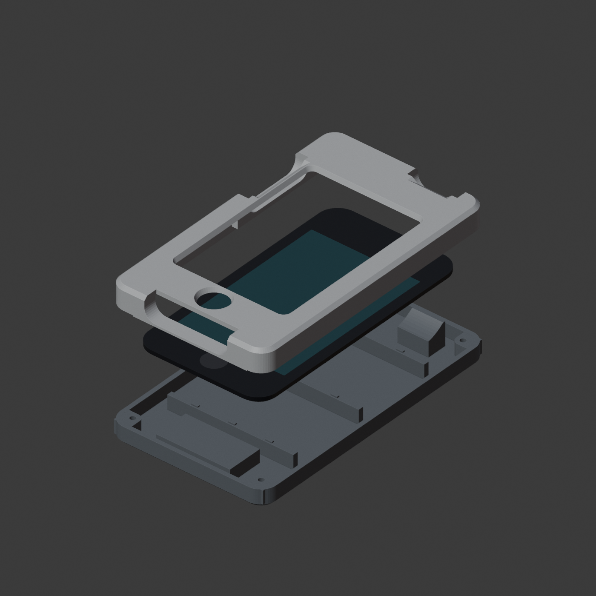
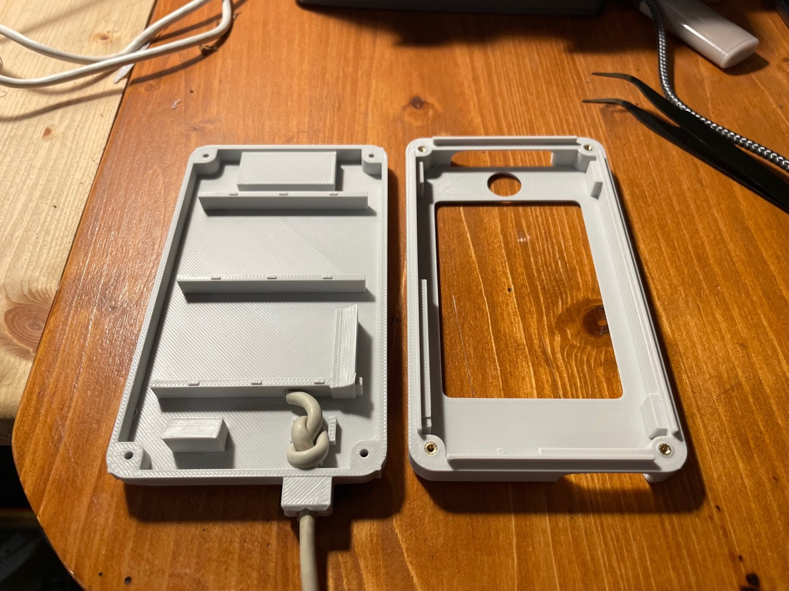
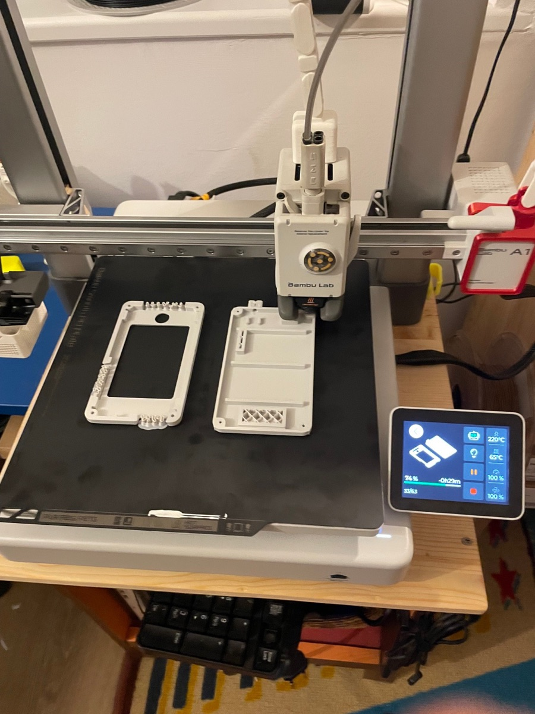
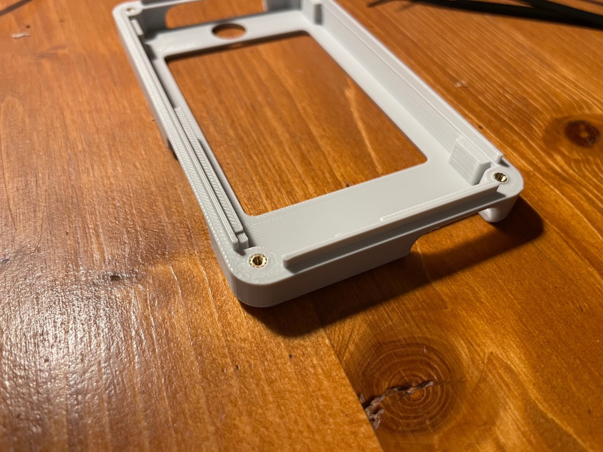
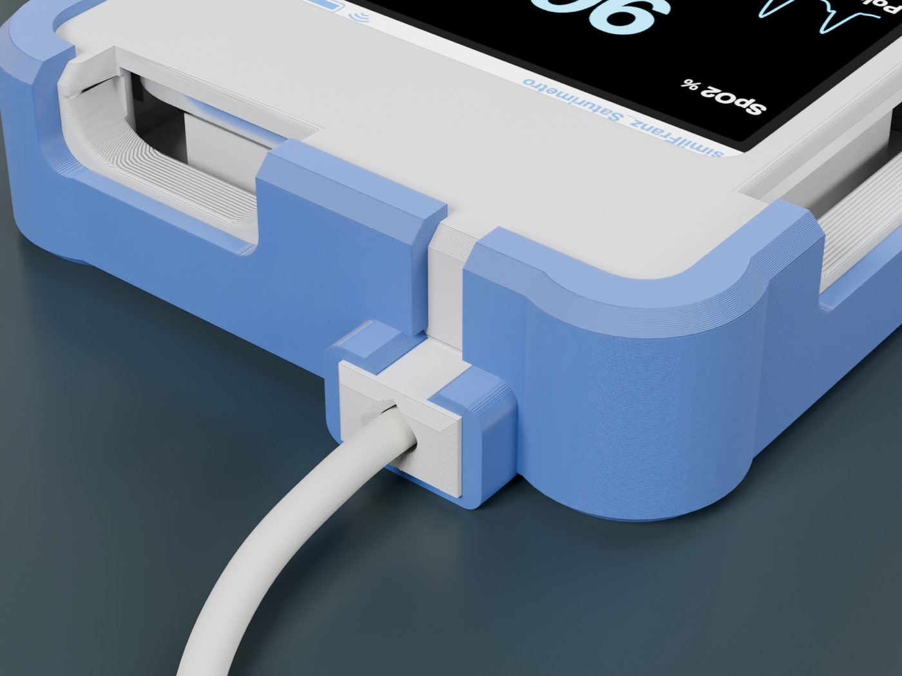
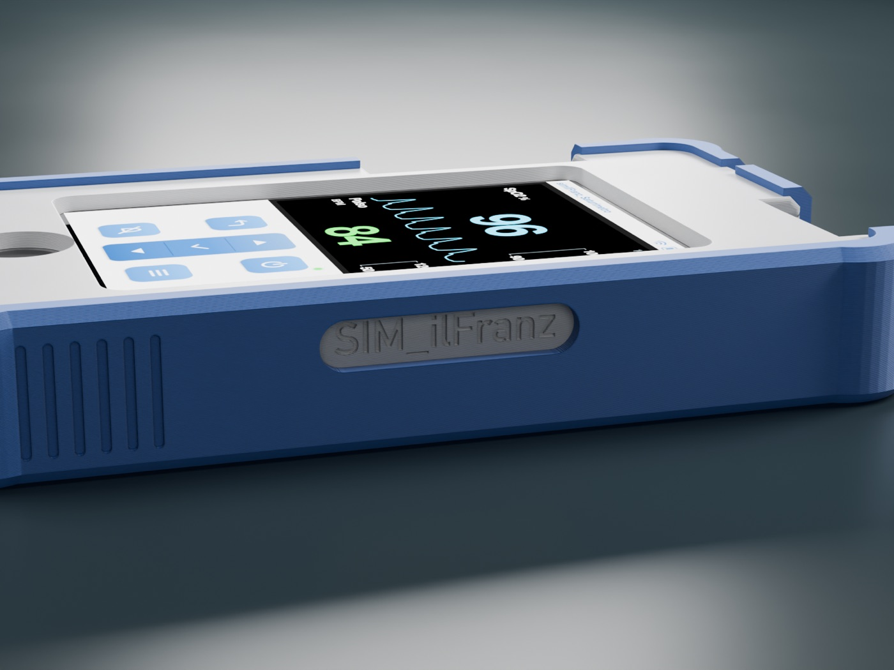

# 3. Stampa e monta il guscio

È il momento in cui l'iPod smette di sembrare un iPod. Due pezzi, un piatto solo, meno di due ore di stampa:
la **cornice** bianca davanti, con finestra del display e conche per i tasti, e la **scocca** dietro,
con l'ingresso per il cavo della sonda. Misure finali: 71,4 × 123,5 × 18 mm.

<p align="center">
  
  
</p>

## I file

| File | Cosa contiene |
|---|---|
| `stampa3d/Saturimetro_v4.3mf` | **progetto BambuStudio pronto**: cornice e scocca sullo stesso piatto, già impostate |
| `stampa3d/stl/saturimetro_cornice_v4.stl` | cornice, già orientata a faccia in giù |
| `stampa3d/stl/saturimetro_scocca_v4.stl` | scocca, già orientata col dorso sul piatto |
| `stampa3d/sorgenti/saturimetro_guscio.py` | script parametrico per Blender: cambi una misura e rigeneri tutto |

## Stampa

Il progetto `.3mf` è pronto per **Bambu Lab A1 con ugello 0,4**, PLA Basic e piatto liscio PEI:

- profilo 0,20 mm Standard
- **6 giri di parete**: attorno agli inserti filettati c'è solo plastica piena, e gli inserti restano saldi
- **supporti ad albero** automatici per i tetti delle conche, la sede della spina e le lamature
- circa 1 h 50 min e 58 g di filamento

<p align="center"></p>

Con un'altra stampante importi i due STL così come sono, già orientati, e imposti 6 giri di parete e supporti ad albero.
Vuoi la scocca di un altro colore? Stampala a parte.

Sul fianco destro della cornice trovi la scritta incisa **SIM_ilFranz**: con lo script la sostituisci con la tua.

## La minuteria

- 4 **inserti filettati a caldo M2**, lunghi 4 mm, Ø esterno 3,2 mm
- 4 **viti M2×12** a testa cilindrica. La lunghezza giusta è proprio 12 mm: è quella che entra tutta nell'inserto
  e si ferma prima del fondo del foro

## Monta

1. **Libera le sedi** togliendo i supporti dalle conche dei tasti, dalla sede della spina e dalle lamature.
2. **Posa gli inserti.** Saldatore a circa 220 °C (PLA), inserto dritto sul foro della cornice:
   lascialo scendere col suo peso fino a filo, poi premilo un attimo con una superficie piatta.

   
3. **Appoggia l'iPod** nella cornice, col vetro contro il frontale.
4. **Fai entrare la sonda.** Infila il cavo del sensore da dito nel bocchettone della scocca e fermalo
   all'interno con un nodo, come nella foto in alto, oppure con una fascetta ai due ponticelli. Il foro accoglie cavi fino a 3,6 mm: per un cavo più spesso
   allarga `CABLE_D` nello script.
5. **Chiudi** con la scocca e avvita le 4 viti dal dorso. Dei piccoli listelli si schiacciano e tengono
   l'iPod ben premuto contro il frontale (gioco regolabile con `CRUSH_INT`).

I tasti dell'iPod restano raggiungibili dalle conche laterali e la presa dock resta libera per la ricarica.

## Il bumper in TPU (facoltativo)

Un guscio morbido che avvolge il saturimetro: protegge dalle cadute, dà presa e lo fa sembrare
uno strumento da reparto. Rigido quanto basta per tenere la forma, morbido sugli angoli per assorbire gli urti.

<p align="center">
  
  
</p>

**Com'è fatto**

- pareti da 2 mm, angoli rinforzati, dorso pieno
- aperture con 1 mm di margine per i tasti volume e accensione e per la spina di ricarica
- finestrella sul fianco destro: la scritta incisa sulla cornice resta in vista
- righine antiscivolo sui fianchi
- **colletto attorno al bocchettone del cavo sonda**: due fianchi aderenti e due alette con una fessura di 5 mm
  che corre fino al bordino frontale. Il saturimetro si monta **con la sonda già fissata**: il bocchettone
  scende nella fessura, le alette si allargano e gli scattano sopra.

**I file**

| File | Cosa contiene |
|---|---|
| `stampa3d/Bumper_TPU_v6.3mf` | **progetto BambuStudio pronto**: A1 0,4, Generic TPU, piatto testurizzato, tutte le impostazioni |
| `stampa3d/stl/saturimetro_bumper_tpu_v6.stl` | il bumper da solo, già orientato col dorso sul piatto |
| `stampa3d/sorgenti/bumper_tpu.py` | script parametrico (si appoggia a `saturimetro_guscio.py`) |

**Stampa**

| Impostazione | Valore | Perché |
|---|---|---|
| Filamento | TPU 95A (profilo Generic TPU) | 240 °C, piatto 45 °C, ventola al 100%, flusso max 3,2 mm³/s |
| Piatto | PEI testurizzato | il TPU si stacca da solo a piatto freddo |
| Giri di parete | 4 | pareti quasi piene: tiene la forma |
| Riempimento | gyroid 15% | finisce negli angoli: struttura elastica che assorbe gli urti |
| Strati pieni sopra/sotto | 4 / 4 | dorso compatto |
| Ponti spessi | sì | per il bordo alto della finestrella |
| Supporti | **solo nella finestrella** | in BambuStudio usa *Disegna supporti* sul bordo alto della finestrella (un ponte di circa 27 mm); il resto si stampa da solo |

Circa 2 h 20 min e 31 g. Sulla A1 il TPU va sul portabobina esterno, non nell'AMS lite.
Se il filamento è stato all'aria, asciugalo prima (4–6 ore a circa 50 °C): con l'umidità fa fili.

**Montaggio**

1. Appoggia il saturimetro nel bumper partendo dall'alto, col bocchettone sopra la fessura.
2. Premi: la fessura si allarga, il bocchettone passa e le alette gli scattano sopra.
3. Allarga con le dita il bordino frontale lungo i fianchi e in basso, finché si chiude sul frontale.

**Più rigido o più morbido?** Più rigido: giri di parete 5 o riempimento 25%. Più facile da infilare: giri di parete 3.
Alette troppo dure o troppo morbide: cambia `COLLAR_GAP` nello script (fessura più larga = alette più morbide).

## Rigenera il guscio a modo tuo

Con [Blender](https://www.blender.org), anche senza aprirlo:

```bash
cd stampa3d/sorgenti
/Applications/Blender.app/Contents/MacOS/Blender --background --python saturimetro_guscio.py
```

In cima allo script trovi tutti i parametri: giochi, inserti, cavo, testo inciso. La scritta usa un font di sistema
macOS (`TEXT_FONT`): su un altro sistema indica un font bastone in grassetto che hai installato, oppure lascia
`TEXT = ""` per un fianco liscio.

Guscio chiuso? Manca solo il pezzo più bello: [4. Porta lo scenario in sala](04-uso-col-telefono.md)
