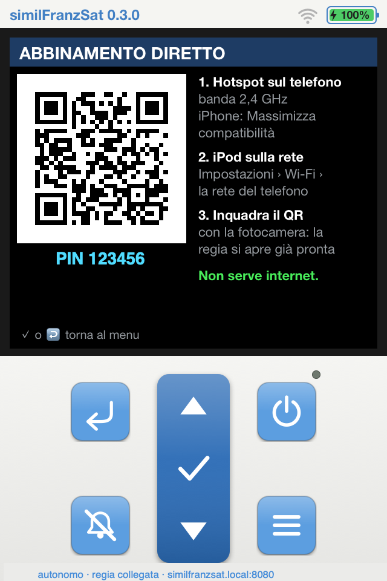
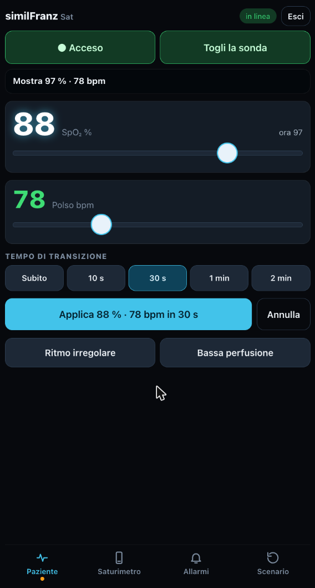

# 4. Porta lo scenario in sala

Ti bastano l'iPod e il tuo telefono. Il telefono crea la rete, l'iPod fa tutto il resto:
simulazione, server e console. Entri in sala o in reparto con lo strumento in tasca e in un minuto sei operativo.

  
  

## Abbinamento diretto: telefono e iPod, nient'altro

Non serve internet: il telefono crea una rete tutta sua e l'iPod ci si collega.

1. **Hotspot sul telefono, a 2,4 GHz**, l'unica banda che l'iPod touch 4 riconosce:
   - **iPhone**: Impostazioni › Hotspot personale, attiva *Massimizza compatibilità*
   - **Android**: nelle impostazioni dell'hotspot scegli *2,4 GHz*
2. **iPod sulla rete del telefono**: Impostazioni › Wi-Fi › il nome del tuo hotspot. Si fa una volta sola, poi si ricollega da solo.
3. **Apri l'app sull'iPod** e vai in **≡ › Collegamento › Abbinamento diretto**.
4. **Inquadra il QR** con la fotocamera del telefono e tocca il link: la console si apre con il PIN già inserito, e l'iPod esce dal menu e resta spento, pronto per lo scenario.
5. **Aggiungi la pagina alla schermata Home**: la prossima volta la regia è a un tocco.

Dopo 8 secondi senza trovare altri dispositivi, l'iPod lavora da solo: non devi impostare niente.

## Cosa hai in mano

- **In alto, sempre visibili**: accensione e sonda applicata o tolta
- **Paziente**: SpO₂ e polso con i cursori, poi *Applica* con il tempo di transizione che scegli (subito, 10 s, 30 s, 1 min, 2 min); ritmo irregolare e bassa perfusione
- **Saturimetro**: silenzia gli allarmi per 2 minuti; **tempo di rilevamento**, cioè quanto impiega a mostrare i valori dopo che la sonda è sul dito (automatico 5–10 s, oppure 3, 5, 10, 20, 30 s)
- **Allarmi**: volume e limiti (predefiniti SpO₂ 85–100, polso 30–170)
- **Scenario**: azzera tutto, spegne lo strumento e stacca la sonda, pronto per il prossimo gruppo

## Sull'iPod: tasti e tocchi

Il saturimetro si usa anche dall'iPod, come uno strumento vero:

- **⏻ tenuto premuto un secondo**: accende o spegne. All'accensione la sonda risulta sempre staccata.
- **🔕**: silenzia gli allarmi per 2 minuti (di nuovo per riattivarli).
- **≡**: apre il menu (limiti, volumi, collegamento, informazioni). **▲ ▼** scorrono, **✓** conferma, **↩** torna indietro.
- **Tocco sullo schermo con la sonda non applicata** (sui numeri o sulla curva): applica la sonda. Dopo il tempo di rilevamento compaiono i valori.
- **Tocco sul numero della SpO₂ o del polso con la sonda applicata**: apre direttamente i limiti di allarme di quel parametro.

**Chi applica la sonda? Scegli tu.** Quando la sonda viene messa sul paziente simulato, il saturimetro deve saperlo, e ci sono due possibilità:

- **la attiva l'istruttore**, con *Applica la sonda* dalla console oppure con un tocco sullo schermo mentre la posiziona;
- **la attiva il partecipante in autonomia**: mette la sonda e tocca lo schermo, come parte del gesto.

I tocchi non staccano mai la sonda: per toglierla usa la console (o lo scenario la stacca da solo al reset).

## Piccoli trucchi

- **iPhone**: l'hotspot si spegne da solo dopo circa 90 secondi senza nessuno collegato. Tieni aperta la sua schermata finché l'iPod si collega.
- **Android**: spesso l'hotspot funziona anche senza dati né SIM, perfetto per le sale senza copertura.
- **Niente fotocamera a portata?** L'indirizzo e il PIN sono anche in ≡ › Informazioni. Se chiami l'iPod *similFranzSat* (da Finder o iTunes quando è collegato al Mac, oppure con `idevicename similFranzSat`), su iPhone funziona anche `http://similfranzsat.local:8080`, sempre uguale qualunque rete tu usi.

Buona simulazione. E quando migliori qualcosa, raccontalo: [fallo tuo](../README.md#fallo-tuo).
